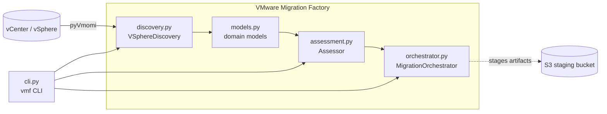

# VMware Migration Factory

Discover VMware vSphere workloads, right-size them onto AWS/Azure/GCP instance
families, and track each virtual machine through its migration lifecycle.

[](LICENSE)
[](https://github.com/abhisheksawant52/vmware-migration-factory/actions/workflows/ci.yml)
[](https://www.python.org/)

## Overview

VMware Migration Factory is a command-line toolkit for planning and tracking the
migration of vSphere virtual machines to the public cloud. It automates the three
recurring phases of a migration wave: **discovery** of source inventory from
vCenter, **assessment** that right-sizes each workload onto a target cloud
instance family with a cost estimate and a 6 Rs disposition, and
**orchestration** that moves each VM through a well-defined migration lifecycle.

It is aimed at cloud migration and platform engineering teams who need a
repeatable, scriptable way to turn a raw vCenter inventory into a costed,
prioritized migration plan. The discovery layer wraps
[pyVmomi](https://github.com/vmware/pyvmomi), but the parsing and right-sizing
logic is deliberately decoupled from any live connection so it can be exercised
offline against inventory exports and fixtures.

The included Terraform scaffold provisions a minimal AWS landing zone (an
encrypted S3 staging bucket plus an IAM role for migration agents) that gives the
factory somewhere to stage replicated disks and artifacts.

## Architecture



**Components**

- `discovery.py` — `VSphereDiscovery` connects to vCenter via `SmartConnect` and
  maps managed VM objects into domain models; `from_records` builds the same
  models from raw dictionaries for offline use.
- `assessment.py` — `Assessor` selects the cheapest instance type that fits each
  VM (with headroom), estimates monthly compute + storage cost, and assigns a
  disposition.
- `orchestrator.py` — `MigrationOrchestrator` registers jobs and enforces valid
  lifecycle transitions.
- `models.py` — pydantic models for `VirtualMachine`, `Recommendation`, and
  `MigrationJob`.
- `config.py` / `logging_config.py` — settings and structured logging.
- `terraform/` — AWS landing-zone infrastructure for staging.

## Features

- vCenter discovery via pyVmomi with an offline-testable mapping layer.
- Right-sizing across AWS, Azure, and GCP instance catalogs with configurable
  capacity headroom.
- Monthly cost estimates combining on-demand compute and block storage.
- 6 Rs disposition heuristics (rehost, replatform, retire, ...).
- Lifecycle orchestration: discovered -> assessed -> replicating -> cutover ->
  validated -> complete, with invalid transitions rejected.
- `vmf` CLI with `discover`, `assess`, `migrate`, and `report` subcommands.
- Terraform AWS landing zone (encrypted S3 staging bucket + IAM agent role).
- Full open-source hygiene: CI, pre-commit, issue/PR templates, dependabot.

## Tech Stack

- **Language:** Python 3.11+
- **Libraries:** pyVmomi, pydantic, pydantic-settings, Click
- **Infrastructure:** Terraform (AWS provider)
- **Tooling:** ruff, black, pytest, pre-commit, GitHub Actions

## Getting Started

### Prerequisites

- Python 3.11 or newer
- (Optional) Terraform 1.5+ and AWS credentials for the landing zone
- (Optional) Network access to a vCenter server for live discovery

### Install

```bash
make install          # editable install with dev extras
cp .env.example .env   # then edit vCenter / target-cloud settings
```

### Configure

Settings are read from environment variables prefixed with `VMF_` (see
[Configuration](#configuration)); a local `.env` file is loaded automatically.

### Run

```bash
# Discover from a local inventory export (no vCenter needed)
vmf discover --inventory examples/inventory.example.json

# Right-size onto a target cloud
vmf assess --inventory examples/inventory.example.json --target-cloud aws

# Drive jobs through the full lifecycle
vmf migrate --inventory examples/inventory.example.json

# Produce a JSON assessment report
vmf report --inventory examples/inventory.example.json --output report.json
```

Run `vmf --help` (or `vmf <command> --help`) for full usage.

## Project Structure

```text
vmware-migration-factory/
├── src/vmware_migration/
│   ├── __init__.py
│   ├── cli.py             # Click entrypoint (vmf)
│   ├── config.py          # pydantic-settings configuration
│   ├── logging_config.py  # logging setup
│   ├── models.py          # VirtualMachine, Recommendation, MigrationJob
│   ├── discovery.py       # VSphereDiscovery (pyVmomi wrapper)
│   ├── assessment.py      # Assessor (right-sizing + cost)
│   └── orchestrator.py    # MigrationOrchestrator (lifecycle)
├── tests/                 # pytest unit tests
├── examples/              # sample inventory export
├── terraform/             # AWS landing-zone (root module + module + envs)
│   ├── modules/migration_staging/
│   └── environments/{dev,prod}/
├── Dockerfile
├── Makefile
└── pyproject.toml
```

## Configuration

All variables are prefixed with `VMF_` and can be set in the environment or a
`.env` file. See [`.env.example`](.env.example).

| Variable                | Description                                | Default                          |
| ----------------------- | ------------------------------------------ | -------------------------------- |
| `VMF_VCENTER_HOST`      | vCenter server hostname or IP              | `vcenter.example.local`          |
| `VMF_VCENTER_USER`      | vCenter login user                         | `administrator@vsphere.local`    |
| `VMF_VCENTER_PASSWORD`  | vCenter login password                     | _(empty)_                        |
| `VMF_VCENTER_PORT`      | vCenter API port                           | `443`                            |
| `VMF_VCENTER_INSECURE`  | Skip TLS verification                      | `false`                          |
| `VMF_DATACENTER`        | Source datacenter name                     | `Datacenter`                     |
| `VMF_TARGET_CLOUD`      | Default target cloud (`aws`/`azure`/`gcp`) | `aws`                            |
| `VMF_LOG_LEVEL`         | Root logging level                         | `INFO`                           |

## Deployment

The `terraform/` directory provisions the AWS landing zone the factory stages
into. It is composed of a root module that wires in the reusable
`modules/migration_staging` submodule, with per-environment tfvars under
`environments/dev` and `environments/prod`.

```bash
cd terraform
terraform init -backend-config=environments/dev/backend.hcl.example
terraform plan  -var-file=environments/dev/dev.tfvars.example
terraform apply -var-file=environments/dev/dev.tfvars.example
```

The CLI itself can also be packaged as a container:

```bash
docker build -t vmware-migration-factory .
docker run --rm vmware-migration-factory --help
```

## Contributing

Contributions are welcome — please read [CONTRIBUTING.md](CONTRIBUTING.md) and our
[Code of Conduct](CODE_OF_CONDUCT.md).

## Security

Please review our [Security Policy](SECURITY.md) for how to report
vulnerabilities responsibly.

## License

Distributed under the terms of the [MIT License](LICENSE).
